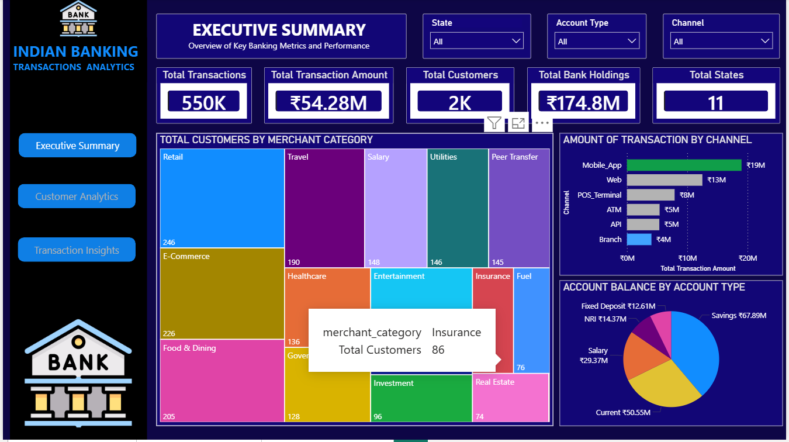
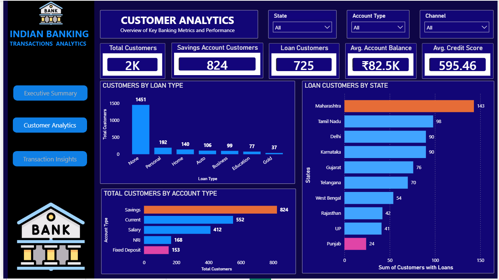
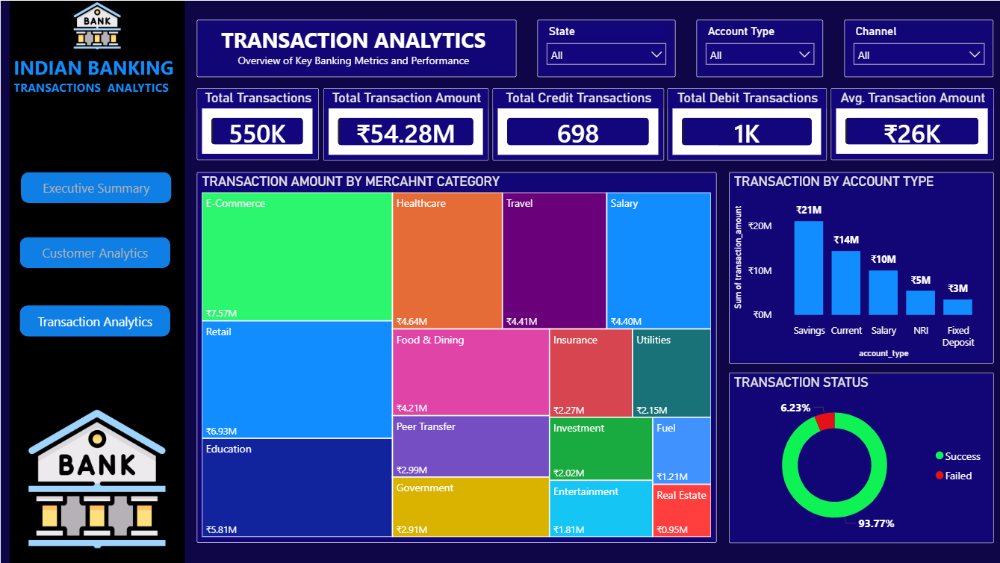

# Indian Banking Transactions & Financial Intelligence Dashboard (Power BI)

## 📌 Project Overview
This project delivers a robust, corporate-level banking intelligence solution engineered to evaluate transactional behavior, customer demographics, and channel performance for an **Indian Financial Institution**. 

Analyzing over **550K transaction records** representing **₹54.28M** in volume, this multi-page interactive dashboard provides financial stakeholders with immediate visibility into liquidity reserves, credit health, loan distribution, and merchant velocity across 11 major Indian states.

---

## 📂 Repository Structure & Data Access
To ensure full reproducibility, all core analytical workspace assets and source files are structured directly within this repository:
*   **[/data](/data):** Contains the raw transactional database tracking account numbers, merchant categories, amounts, states, and success flags.
*   **`Indian_Banking_Analytics.pbix`:** The primary Power BI workspace housing the data model, custom DAX measures, and bookmark-driven user interface.

---

## 🛠️ Tech Stack & Advanced Power BI Features Used
*   **Advanced DAX (Data Analysis Expressions):** Engineered complex calculated measures to track unique counts (`Total Customers`), aggregated summaries (`Total Bank Holdings`), multi-variable ratios, and customized averages (`Avg. Credit Score`, `Avg. Account Balance`).
*   **Interactive UI/UX Navigation Pane:** Formulated a clean, modern sidebar menu utilizing native Power BI **Bookmarks & Action Buttons** to provide a seamless application-like menu experience (holding `CTRL + Click` to cycle sheets instantaneously).
*   **Advanced Presentational Layouts:** Implemented varied visualization engines including Treemaps for multi-variable categorical tracking, donut charts for status proportions, and ranked horizontal bar indicators.
*   **Synchronized Data Filtering:** Implemented cross-report slicers (**State, Account Type, Channel**) to preserve filter states across separate presentation sheets.

---

*   **Key Dimension Keys utilized:** Account Types (`Savings`, `Current`, `Salary`, `NRI`, `Fixed Deposit`), Channel Routing (`Mobile App`, `Web`, `POS Terminal`, `ATM`, `API`, `Branch`), and Geographic Vectors (`State`).

---

## 🚀 Page-by-Page Analytical Breakdown

### Page 1: Executive Summary (Financial Baseline)
*   **Focus:** Core institutional metrics, transaction volumes, and categorical channel flow.
*   **Key Insights:** Tracks a solid **₹174.8M in Total Bank Holdings** across **2K customers**. It exposes **Mobile_App** as the primary revenue channel driving **₹19M** in velocity, while **Savings accounts** hold the majority liquidity slice at **₹67.89M**.
*   **Visual Snapshot:**

### Page 2: Customer Analytics (Demographics & Risk)
*   **Focus:** Loan concentrations, regional customer densities, and credit health profiles.
*   **Key Insights:** Evaluates credit safety metrics showing a baseline **Average Credit Score of 595.46**. It maps out geographical loan demands, establishing **Maharashtra** as the top lending territory with **143 active loan clients**, followed closely by **Tamil Nadu (98)**.
*   **Visual Snapshot:**

### Page 3: Transaction Insights (Merchant Velocity)
*   **Focus:** Financial spending behavior by merchant class and payment success rates.
*   **Key Insights:** Leverages an expansive spending treemap identifying **E-Commerce (₹7.57M)** and **Retail (₹6.93M)** as the absolute highest drivers of transaction volumes, while highlighting a highly optimized transaction clearance rate of **93.77% Success** against a minor **6.23% Failure** rate.
*   **Visual Snapshot:**

---

## 💡 Key Portfolio Takeaways
1. **Dynamic Interface Control:** The application removes standard sheet clutter by substituting standard tab browsing with an interactive, action-routed sidebar navigation menu.
2. **Financial Risk Analysis:** Synthesized credit attributes with localized geographical layers to pinpoint risk hotspots, proving an analytical capability to support credit underwriting decisions.
3. **Advanced Matrix Slicing:** Structured high-velocity operational dashboards capable of filtering half a million rows instantly across specific payment mediums, regions, and banking products simultaneously.
